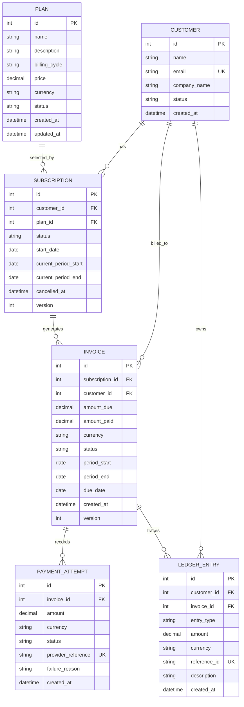
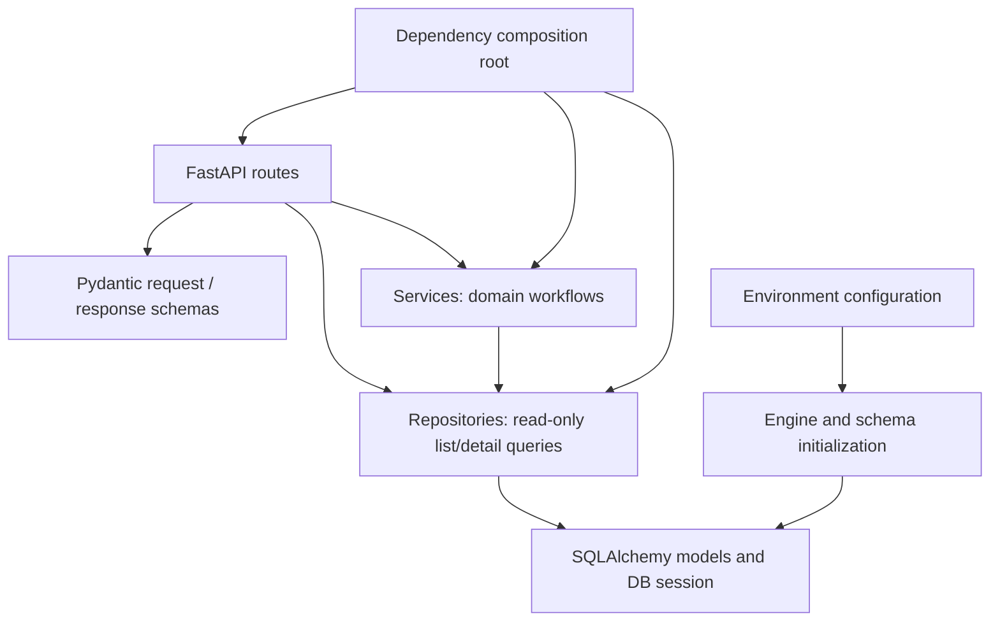
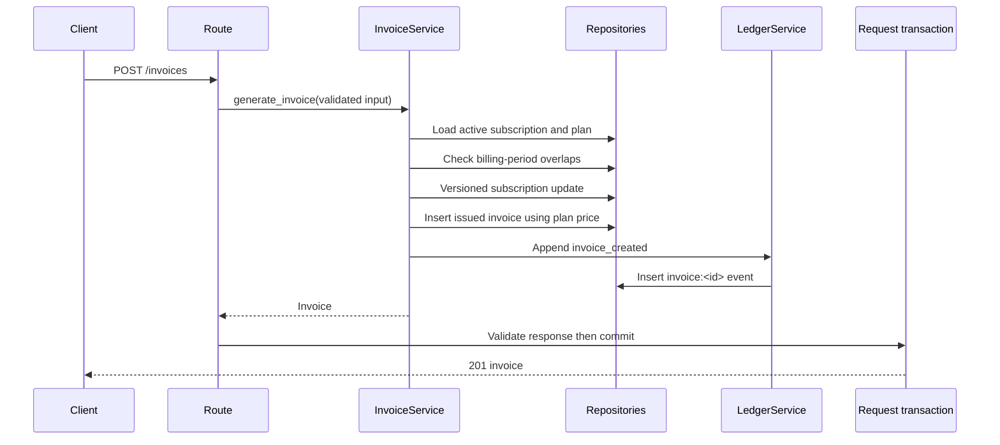
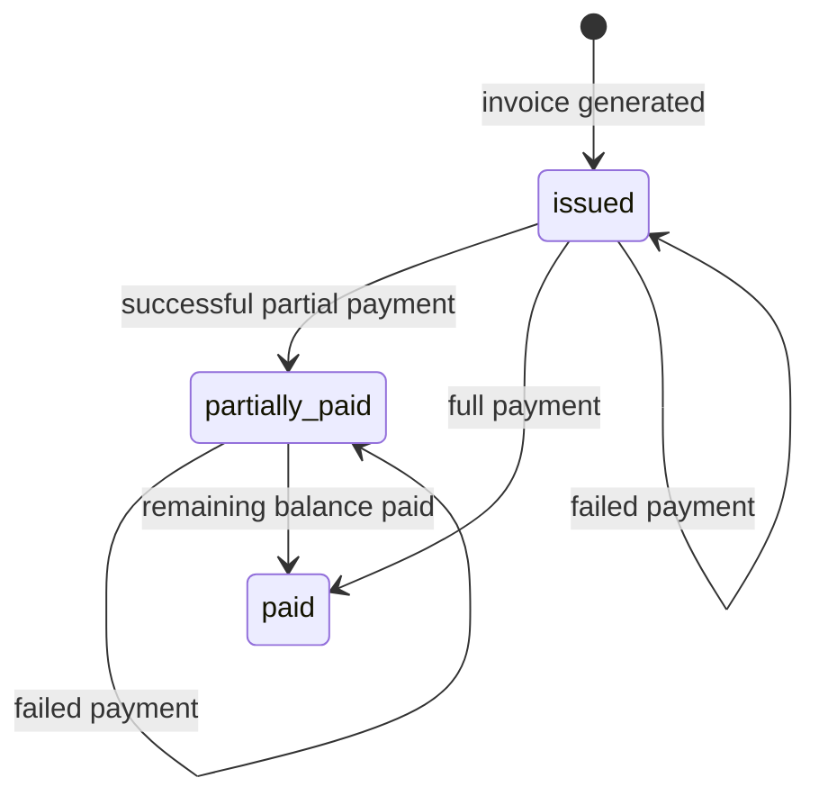

# SubLedger low-level design

## Goal and boundaries

Build a small, understandable backend for a SaaS billing lifecycle: configure a
plan, register a customer, subscribe, generate an invoice, record payments, and
retain a traceable event history. Separate persistence, validation, workflows,
HTTP concerns, dependency wiring, and configuration.

Real payment processing, UI, tax, proration, and authentication are excluded.
This is a single-node SQLite implementation. README documents API and scope
assumptions. The coverage table below maps the supplied assignment screenshots
to the implementation and verification.

## Entity relationship diagram



`version` is the added field on invoices and subscriptions: SQLAlchemy compares it
when updating, rejecting stale writes. Invoice customer ID is deliberately stored
to make customer billing queries straightforward; InvoiceService derives it from
the subscription, so clients cannot choose it independently.

All foreign keys are restrictive; no cascading deletion of financial history.
Indexes support customer, plan, subscription, and invoice lookups. A partial unique
index enforces one active subscription per customer/plan, while allowing history.
Invoice periods have an exact-period unique constraint plus a service overlap check.
Ledger reference IDs take `invoice:<id>` or `payment_attempt:<id>` forms.

## Layers and dependencies



| File/directory | Responsibility |
| --- | --- |
| `app/routes/` | HTTP input/output, response models, status codes, delegation |
| `app/schemas.py` | Structural validation, decimal precision, supported currencies, enums |
| `app/services.py` | Business decisions and workflows; no SQL or session construction |
| `app/repositories.py` | SQL queries, persistence, flush; no HTTP decisions or commits |
| `app/models.py` | Persistent entities, relationships, constraints, UTC timestamp adapter |
| `app/db.py` | Engine/session factory, SQLite foreign keys, schema and ledger triggers |
| `app/config.py` | Cached environment settings and `.env` support |
| `app/dependencies.py` | Request session, transaction boundary, injected object graph |
| `app/errors.py` | Domain errors independent of FastAPI |
| `app/main.py` | App lifespan, router registration, HTTP error translation, health |

## Service responsibilities

| Service | Logic it owns | What it must not do | Dependencies |
| --- | --- | --- | --- |
| PlanService | Validate plan price/cycle/currency/status; create, fetch, update/deactivate plans | Generate invoices, manage subscriptions, or record payments | PlanRepository |
| CustomerService | Register/update/fetch customer profiles; check normalized email uniqueness | Calculate charges or alter subscription/payment state | CustomerRepository |
| SubscriptionService | Validate active plan/customer; prevent duplicate active subscriptions; calculate initial period; create/activate/cancel/fetch | Issue invoices, collect payments, or edit ledger history | SubscriptionRepository, CustomerRepository, PlanRepository |
| InvoiceService | Validate subscription/period; calculate and snapshot amount due; generate invoice and event; apply successful payments to totals/status | Record payment attempts, call gateways, or manage plan/customer lifecycle | SubscriptionRepository, PlanRepository, InvoiceRepository, LedgerService |
| PaymentService | Record attempts; validate amount/currency/state/reference; trigger InvoiceService update and ledger event | Calculate plan prices, directly implement invoice state transitions, or edit past attempts/events | InvoiceRepository, PaymentAttemptRepository, InvoiceService, LedgerService |
| LedgerService | Append traceable invoice/payment events; fetch customer ledger history | Update/delete entries, change invoice balances, or decide payment success | LedgerRepository, CustomerRepository |

All services avoid SQL, HTTP responses, session construction, and transaction commits.
PlanService reuses PlanCreate validation for non-HTTP callers and validates merged
state before applying a partial plan update. Active/inactive plan transitions are
allowed in both directions. Existing invoice amounts, currencies, and periods are
unchanged by edits to the plan.

## Repository responsibilities

| Repository | Entities read/written | Common methods / responsibility |
| --- | --- | --- |
| PlanRepository | Plan | `get`, `list`, `create`, `update` |
| CustomerRepository | Customer | `get`, `list`, `create`, `update`, `by_email` |
| SubscriptionRepository | Subscription | `get`, `list`, `create`, `update`, `active_for` |
| InvoiceRepository | Invoice | `get`, `list`, `create`, `update`, `overlapping` |
| PaymentAttemptRepository | PaymentAttempt | `get`, `list`, `create`, `by_reference` |
| LedgerRepository | LedgerEntry | `append`, filtered `list`; no update/delete API |

The small common repository base removes repetitive get/list/create/update code.
The payment API exposes no update operation even though the shared base supports
it. The ledger uses a separate class so it never inherits update operations.

## Business-rule ownership

| Rule | Primary owner | Defense in depth |
| --- | --- | --- |
| Price strictly positive | Plan schema + PlanService | Plan database CHECK |
| Valid plan billing cycle/currency/status changes | Plan schemas + PlanService | Model status/cycle CHECKs |
| Unique customer email | CustomerService + CustomerRepository, normalized schemas | Unique database constraint |
| Inactive plan cannot receive subscriptions | SubscriptionService | Domain test |
| One active customer-plan subscription, including reactivation | SubscriptionService + SubscriptionRepository | Partial unique index |
| Inactive customer cannot subscribe | SubscriptionService | Domain test |
| Only active subscriptions generate invoices | InvoiceService | Version check guards cancellation races |
| Price fixed at invoice generation | InvoiceService | Immutable invoice write API |
| Valid, non-overlapping invoice period | Schema + InvoiceService | Exact-period unique index; subscription version check |
| Positive, two-decimal payment | Payment schema | Payment database CHECK |
| Currency matches invoice | PaymentService | API test |
| Success cannot exceed unpaid balance | PaymentService | Invoice CHECK + optimistic version |
| Full payment => paid; partial => partially_paid | InvoiceService, triggered by PaymentService | API tests |
| Failure leaves amount paid unchanged | PaymentService | API test with persisted failure event |
| Unique reference per payment attempt | PaymentService | Database unique constraint |
| Failure reason only on failed attempts | Payment schema | API validation tests |
| Append-only, traceable ledger | LedgerService, LedgerRepository | Unique reference, ORM guards, SQLite UPDATE/DELETE triggers |
| Invoice/payment and ledger commit together | Request unit of work | Rollback tests with injected ledger failures |

Request schemas enforce input shape and local value constraints. Stateful rules
live in services. Constraints handle duplicate races and invalid persistent state.

## Patterns and SOLID

- **Repository pattern:** SQLAlchemy queries are isolated behind entity repositories.
  Services work with repository methods instead of `select` or sessions.
- **Service layer:** InvoiceService and PaymentService own workflows spanning
  several repositories. Routes contain no billing calculations.
- **Dependency injection:** FastAPI injects one request-scoped Services object;
  its constructor composes repositories and services sharing the same session.
  Tests replace the session dependency without editing application code.
- **Unit of work:** `get_session` commits once after successful route processing
  and response validation, before the response is sent (`scope="function"`). Every
  exception rolls back the shared transaction. Repositories only flush.
- **Single responsibility:** plan, customer, subscription, invoice, payment, and
  journal decisions have distinct service owners. Models handle persistence only.
- **Dependency inversion:** service constructors accept repository collaborators
  and LedgerService, without constructing SQLAlchemy sessions or FastAPI objects.
  Python duck typing keeps the small project readable; explicit protocols can be
  introduced when multiple repository implementations become necessary.
- **Interface segregation:** LedgerRepository deliberately exposes only append
  and list. There is no generic public financial-record delete endpoint.
- **Open/closed tradeoff:** invoice pricing and billing-cycle calculations are
  intentionally small. Additional tax/discount policies could become injected
  strategies; no speculative strategy hierarchy is needed for three fixed cycles.

## Invoice generation flow



1. Require the subscription to exist and be active.
2. Read the plan, select supplied dates or the subscription's initial period.
3. Require a period on/after subscription start, end after start, and no overlap.
4. Touch the versioned subscription so concurrent cancellation/generation conflicts.
5. Store current plan price and currency in an `issued` invoice; amount paid starts at zero.
6. Append an `invoice_created` event with reference `invoice:<id>`.
7. Commit both writes, or roll back everything if any operation fails.

Periods are `[start, end)` so adjacent periods do not overlap. Default due date
is seven days after generation. The subscription period is not automatically
advanced; renewal/scheduling is an explicit future extension.

## Payment recording flow

```mermaid
sequenceDiagram
    participant Client
    participant Route
    participant Service as PaymentService
    participant Invoices as InvoiceService
    participant Repos as Repositories
    participant Ledger as LedgerService
    participant UOW as Request transaction
    Client->>Route: POST /payments
    Route->>Service: record_payment(validated input)
    Service->>Repos: Fetch invoice and check provider reference
    Service->>Service: Validate state, currency, remaining amount
    Service->>Repos: Insert PaymentAttempt
    alt success
        Service->>Invoices: apply_successful_payment(invoice, amount)
        Invoices->>Repos: Versioned amount_paid/status update
        Service->>Ledger: Append payment_success
    else failed
        Service->>Ledger: Append payment_failure; invoice unchanged
    end
    Ledger->>Repos: Insert payment_attempt:<id> event
    Service-->>Route: Attempt + current invoice
    Route->>UOW: Validate response then commit
    UOW-->>Client: 201 attempt + invoice
```

PaymentService validates and records the attempt, then delegates invoice changes
to InvoiceService in the same transaction. Successful updates use Decimal addition.
If `amount_paid == amount_due`,
the invoice becomes `paid`; otherwise it becomes `partially_paid`. A failed
attempt retains the invoice's amount and status, stores its failure reason, and
produces a failure event whose amount is the attempted amount. Invoices remain
payable after subscription cancellation.



`draft`, `overdue`, and `void` are reserved model states. This base API does not
create or transition to them; draft/void/paid invoices cannot accept attempts.

## Subscription activation and plan changes

Creation returns an active subscription. Cancellation is immediate and repeatable.
`POST /subscriptions/{subscription_id}/activate` reactivates a cancelled subscription
after checking active customer/plan and the absence of another active customer-plan
subscription. The database partial unique index closes concurrent activation/create
races; the version column detects stale lifecycle updates. Activating an already
active subscription is a no-op. Reactivation clears the latest cancellation marker
and preserves its original dates, invoices, payments, and ledger entries. It does
not automatically renew periods or create invoices.

Plan PATCH accepts name, description, price, billing_cycle, currency, and status.
Changing a plan does not rewrite issued invoices or stored subscription periods.
New subscriptions use the updated cycle. New invoices snapshot the updated price
and currency. Explicitly supply subsequent invoice periods, as there is no renewal
scheduler. This can produce multiple currencies in a customer's event history;
each event retains its own currency and amounts must never be summed across currencies.

## Assignment requirement coverage

| Supplied requirement | Implementation / deliverable | Verification |
| --- | --- | --- |
| Create/update/list/deactivate plans with price, cycle, currency, status | PlanCreate/PlanUpdate, PlanService, `/plans` routes | Invalid prices/edits, deactivation, cycle/currency/price snapshot tests |
| Create/list customers with unique email and company/contact details | Customer schemas/service/repository, `/customers`; name, email, company_name | Email normalization/uniqueness tests; demo creates customer |
| Create/activate/cancel/fetch subscriptions; prevent duplicate active plans | SubscriptionService, `/subscriptions`, `/{id}/activate`, `/{id}/cancel`, `/{id}` | Activation, inactive plan/customer, duplicate activation, cancellation, history preservation tests |
| Generate invoices for active subscriptions and track totals/status/period | InvoiceService, Invoice model and `/invoices` | Active-state, snapshots, overlaps, period validation, partial/full payment tests |
| Record success/failure; success updates invoice, failure leaves paid amount unchanged | PaymentService orchestrates InvoiceService and LedgerService | Success/partial/failure/overpayment/duplicate reference and rollback tests |
| Append-only invoice_created/payment_success/payment_failure ledger | LedgerService/Repository, ORM guards and DB triggers | Event reference/type tests and raw SQL/ORM mutation rejection tests |
| Exact visible API paths: POST/GET `/plans`, PATCH `/plans/{plan_id}`, POST `/customers` | Root paths shown in Swagger; `/api/v1` remains a compatibility alias | Required-path/OpenAPI and alias tests |
| Mandatory ERD | Entity relationship diagram above | Mermaid source in this document |
| Mandatory service responsibility table, including what services should not do | Service responsibilities above | Explicit ownership, exclusions, and dependencies |
| Mandatory repository responsibility table: entities and methods | Repository responsibilities above | Repository classes and method mapping |
| Mandatory business-rule ownership | Business-rule ownership above | Maps all seven supplied examples plus additional invariants |
| At least one design pattern and rationale | Patterns and SOLID above | Repository, Service Layer, DI, Unit of Work |
| Invoice generation and payment recording flows | Numbered flow, sequence/state diagrams above | Integration tests plus executable HTTP demo |
| At least five business-rule tests | `tests/test_billing.py`, `tests/test_assignment_requirements.py` | `python -m pytest -q` |
| README, assumptions/limitations, local/Docker setup | README.md, .env.example, Dockerfile, compose.yaml | Local tests/demo; Docker runtime verification depends on Docker Engine |
| GitHub repository link | Publish these project files to the submission repository | Final submission step performed by the repository owner |

The optional class diagram is omitted because the ERD, dependency diagram, and
responsibility tables already describe the small design. The supplied endpoint
image contains four API rows; the remaining API surfaces implement the functional
requirements and are listed in README and Swagger.

## Consistency, failures, and concurrency

- Each request shares one SQLAlchemy session and transaction. Flush obtains IDs
  and checks constraints; it is not a commit. Failure after an invoice/payment
  insert still rolls back that insert and every associated change.
- SQLAlchemy version columns detect stale invoice writes: two requests cannot
  silently overwrite `amount_paid`. A conflicting update receives 409 and its
  attempted payment insert rolls back. Fetch current state before retrying.
- Subscription versioning similarly detects concurrent cancellation and invoice
  generation, or conflicting overlapping-period generation.
- Unique database constraints close races for active subscriptions, emails,
  provider references, exact invoice periods, and ledger references.
- SQLite serializes writers; lock contention can return 503 with `Retry-After`.
  There are no automatic retries that might duplicate an external attempt.
- Ledger mutation is blocked both by ORM events and database triggers, including
  raw SQL UPDATE/DELETE. Administrators with schema access can remove triggers;
  this is an application integrity guarantee, not a tamper-proof audit service.
- Positive amounts live in `Numeric(14,2)` columns. Currency is copied consistently
  through invoice/payment/event workflows. SQLite is not a native fixed-decimal
  engine; the bounded two-decimal range plus Decimal validation/arithmetic suits
  this assignment. A production financial store should use PostgreSQL NUMERIC
  or integer minor units with explicit currency scales.

## Extension points and tradeoffs

Use Alembic migrations before evolving an existing database: `create_all` only
creates missing tables. Moving to PostgreSQL requires its driver, engine settings,
partial-index declaration, migration definitions, and equivalent ledger triggers;
changing DATABASE_URL alone is intentionally rejected. Add authentication and
authorization before exposing write APIs publicly. Gateway integration should
verify signed provider events and use durable idempotency and an outbox; never
infer a real charge from a client-supplied success flag. Renewal jobs, refunds,
credits, and double-entry accounting each need separate state transitions and
new immutable events rather than editing past ledger entries.

Tests exercise the actual schema and SQLite triggers, including rollback after
injected ledger failures and stale-session concurrency. The demo script exercises
the complete HTTP workflow against a running server.
